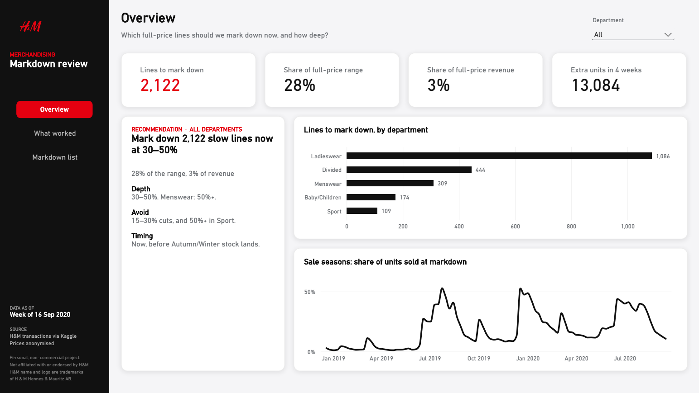
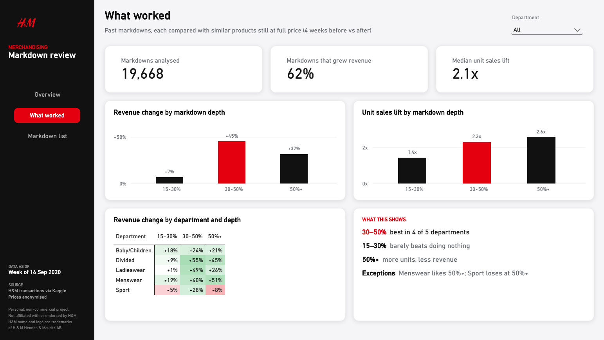
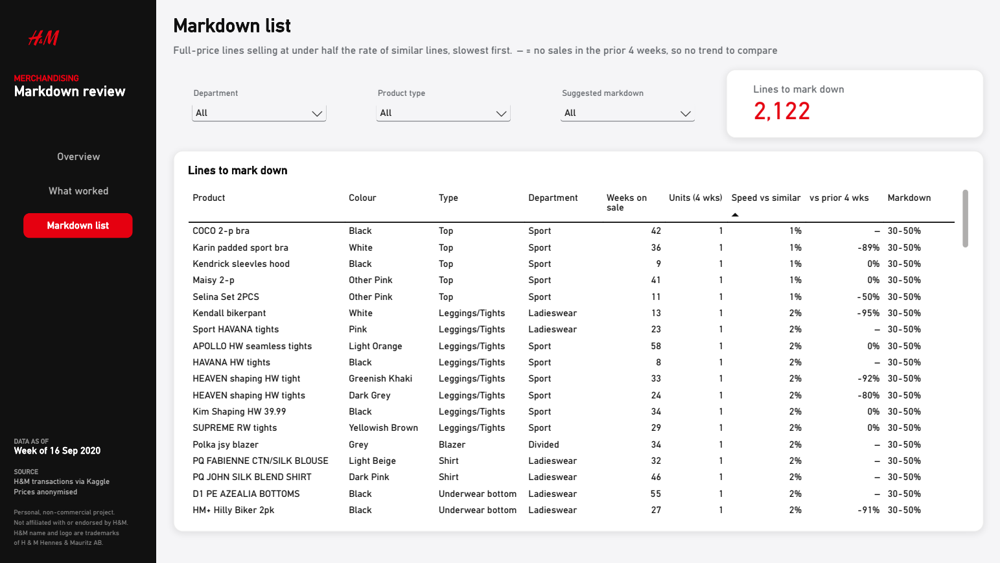

# Which H&M lines should we mark down, and how deep?

**Markdown optimisation** using H&M's real sales data: 31.8 million transactions, Sep 2018 – Sep 2020.
**Tools:** Google BigQuery (SQL) · Power BI

## The recommendation

> **Mark down 2,122 slow-selling full-price lines now, at 30–50% off (50%+ for Menswear).**
>
> - They're **28% of the full-price range but only 3% of revenue**.
> - Past markdowns at 30–50% **grew revenue by 45%** vs similar full-price products.
> - Expected result: **~13,000 extra units cleared in 4 weeks**, before Autumn/Winter stock lands.
> - **Avoid** shallow 15–30% cuts (barely beat doing nothing) and 50%+ in Sport (revenue fell 8%).

## The problem

It's late September 2020. Summer lines are still on the shop floor at full price
and Autumn/Winter stock is arriving. The merchandising team needs to know **which**
products to mark down and **how deep**. Rather than guess, I learnt from
**19,668 past H&M markdowns** what actually worked, then applied it to today's range.

## Key finding: 30–50% is the sweet spot

| Markdown depth | Unit sales lift | Revenue change | Markdowns that grew revenue |
|---|---|---|---|
| 15–30% | 1.4× | +7% | 53% |
| **30–50%** | **2.3×** | **+45%** | **67%** |
| 50%+ | 2.6× | +31% | 60% |

Deeper cuts sell a few more units but give away more per unit than they gain.
*(Each markdown is compared with similar products still at full price over the same
weeks, so seasonal peaks like Black Friday aren't credited to the markdown.)*

## How I built it

1. **Loaded** the raw Kaggle export into BigQuery and **reconciled** it: row counts,
   dates, nulls, and every sale matched to a product.
2. **Detected markdowns** from price history (there's no markdown flag): a 15%+ drop
   from launch price that lasts 3 weeks, so short promotions don't count.
3. **Measured each markdown's effect** against similar full-price products.
4. **Flagged today's slow sellers**: full-price lines selling at under half the rate
   of similar lines in the same department.
5. **Built a Power BI dashboard** for the merchandising team: the answer, the
   evidence, and the action list.

**Why these tools:** 31.8M rows of joins and aggregations suit SQL in BigQuery; a
product-week summary cut each query from 3.2 GB scanned to 61 MB. Power BI suits a
merchandising team that reviews this weekly and needs filters, not code.

## Dashboard

| What worked: the evidence | Markdown list: the action list |
|---|---|
|  |  |

## More detail

- [Technical notes](docs/technical_notes.md): data, limitations, pipeline, key decisions, full findings, caveats, how to reproduce
- [SQL](sql/): the six analysis steps, each commented
- [Dashboard notes](docs/dashboard_notes.md): data model, every DAX measure and design choices

---

**Rohan Pradhan** · Data Analyst · [Portfolio](https://rohanprad.github.io) · [LinkedIn](https://linkedin.com/in/rohanprad)

*Data: H&M Group via Kaggle, used for non-commercial portfolio purposes. Personal
project, not affiliated with or endorsed by H&M. The H&M name and logo are
trademarks of H & M Hennes & Mauritz AB.*
